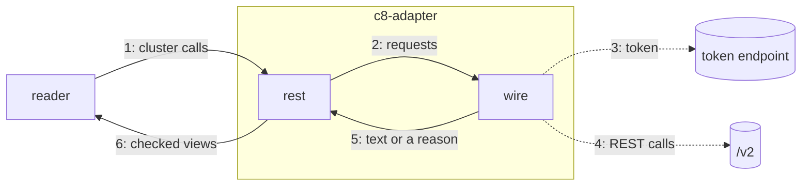

# The C8 adapter

The adapter that reads Camunda 8 for Pulse's questions, on SaaS and Self-Managed, from 8.9 on.

## Why

Camunda 8 has another API than the C7 family, so it gets an adapter of its own that shares no code
with the C7 one. It calls the Orchestration Cluster REST API itself through `@miragon/pulse-http`,
the transport the CLI and the MCP server send through, over the global `fetch` of its host's
runtime ([c8-adapter.md](../../../../../apps/vscode/docs/adr/c8-adapter.md)): no client library
and no child process. Its tokens come from the transport's OAuth client.

## How it works

1. A reader asks the REST client for what it needs, e.g. "the open incidents of instance X".
2. `rest` turns that into requests to the wire: a GET, a search as a reading POST, or a diagram's XML.
3. With client credentials the wire gets a token from the connection's token source, one per client and secret.
4. It sends the request on a read-only connection, never follows a redirect, stops after 60 s or 64 MiB.
5. It answers with the text or with a reason, data that names no type of the transport.
6. `rest` checks each field it reads; `errors` turns a failure into a `RuntimeError` with its way out.

## Where things are

- `packages/connectors/c8/c8-adapter/src`: `CamundaClients` builds a client per connection and holds the token sources
- `packages/connectors/c8/c8-adapter/src/wire`: `CamundaWire` over the transport, the token sources and the reasons of each failure
- `packages/connectors/c8/c8-adapter/src/rest`: the REST client: requests, paging, parsed and checked views
- `packages/connectors/c8/c8-adapter/src/errors`: `ErrorTranslation` and `TokenTexts`, from a failure to a `RuntimeError`
- `packages/connectors/c8/c8-adapter/src/reading`: one reader per question (definitions, diagrams, element statistics, called processes, instances and their counts, an instance's detail and wait states, incidents, variable names) and the version floor
- `packages/connectors/c8/c8-adapter/src/mapping`: keys, page cursors, the BPMN text reader, and the views mapped onto engine-core's read models (the root cause by its `RootCauses`)

## Rules

- `packages/connectors/c8/c8-adapter/src` imports only engine-core's main entry, the runtime view's ports and, in its wire, the main entry and `./oauth` of `@miragon/pulse-http`; no Node built-in, no c7 package (dependency-cruiser)
- Engine words are allowed here, not in contract, core or webview; classes, no comments (ESLint)
- A secret never appears in an error, and a refused token request is not repeated within its hold
- A key that is no Java long names nothing and costs no call; a capped search says so (`truncated`, `atLeast`) or keeps the cluster's counts

## More

[C8 adapter](../../../../../apps/vscode/docs/adr/c8-adapter.md) · [code structure](../../../../../apps/vscode/docs/adr/code-structure.md) · [runtime contract](../../../../../apps/vscode/docs/adr/runtime-contract.md)
