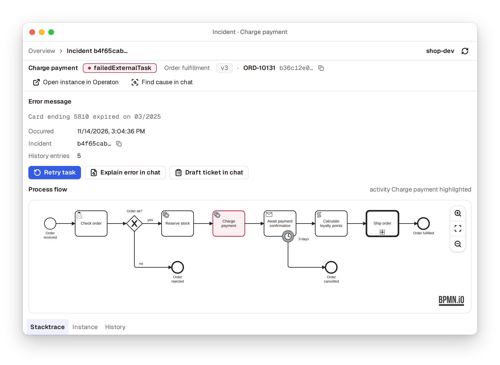

# @miragon/pulse-engine-connector

[](https://www.npmjs.com/package/@miragon/pulse-engine-connector)
[](https://github.com/Miragon/pulse/actions/workflows/ci.yml)
[](https://miragon.github.io/pulse/)

Operate Camunda 7, CIB seven and Operaton engines from any MCP host: the `engine_*` tools and the
interactive views that show incidents, instances and diagrams right in the chat.

<picture>
  <source media="(prefers-color-scheme: dark)" srcset="https://raw.githubusercontent.com/Miragon/pulse/main/docs/assets/widget-incident-dark.png">
  
</picture>

## Install

```sh
npm install @miragon/pulse-engine-connector @miragon/pulse-widget-shell
npm install react react-dom zod lucide-react bpmn-js@18.31.1 @miragon/pulse-ui mcp-use@2.12.2
```

To build your own MCP server on it, start from [pulse-starter](https://github.com/Miragon/pulse-starter).

## Overview

The **engine module** for [Pulse](../../../../README.md): Camunda 7 / CIB Seven BPM operations as
`engine_*` MCP tools, plus the interactive cockpit widgets (MCP Apps). Built on
[`@miragon/pulse-engine-client`](../engine-client), `@miragon/pulse-ui`,
`@miragon/pulse-widget-shell` and [`@miragon/pulse-engine-core`](../engine-core), the
workflow domain pulse-cli runs too, which this module runs over its client.

The server loads this module as `engine` via `engineModule` (`src/module.ts`), which conforms
structurally to the app's `ModuleDefinition` port. The package is published to npm in lockstep with
the other `@miragon/pulse-*` packages (pin them all to one version); the
[pulse-starter](https://github.com/Miragon/pulse-starter) template shows how to compose it
into your own MCP server.

The consumer-shared libraries are ranged **peer dependencies** so they dedupe against your app's
copy: `react`/`react-dom` `^19.2.0`, `zod` `^4.4.0`, `@miragon/pulse-ui` and
`@miragon/pulse-widget-shell` `^<this release>` (the design kit the widgets compose from, and the
view runtime and boot your server shares with every module), `lucide-react` `^0.562.0 || ^1.0.0`
(the widgets' icons; pin a 1.x copy (this repo pins 1.61.0): widget-shell's view root imports
`LucideProvider`, which 0.x lacks, so a deduped 0.x copy fails the bundle build). Your view
bundle's Vite config spreads widget-shell's `VIEW_BUNDLE_DEDUPE` into `resolve.dedupe`. `bpmn-js`
is a peer (`^18.31.1`): the widgets draw BPMN diagrams. **`mcp-use` is exactly pinned**: pin
it to `mcp-use@2.12.2` in your app. A duplicate `mcp-use` instance breaks the React context and
hangs every in-widget query on "Loading…".

## What it provides

- **Operations tools** (`src/tools/`): one file per domain (`process-instances`, `tasks`,
  `incidents`, `jobs`, `history`, …), registered through `createToolRegistrar`. Plain JSON for the
  model.
- **Read composites** (`src/lib/composites.ts`): `engine_inspect_process_instance` (where one
  instance waits and why, running or ended, selected by id, business key or definition key) and
  `engine_status` (the triage of one engine: findings by severity, overall status,
  counts) answer in one call what took several reads. Both run `@miragon/pulse-engine-core` over
  the client, return data without next steps and cap long lists, naming each cut in `truncated`.
- **The view** (`src/widget-tools/cockpit.ts`): `engine_open_cockpit` renders the operations
  cockpit, opening on any of its views, and returns that view's facts as compact JSON; app-only
  `*_data` feeds refresh and navigate inside it.
- **Widgets** (`src/widgets/`): the cockpit app and its routes (overview, incidents, failure
  cluster, process, instances, instance, incident, jobs, history); `src/widgets/views.tsx` maps
  the tool to the cockpit.
- **Multi-engine routing:** every tool resolves its engine through `withEngine` / `resolveEngine`
  (`src/lib/`): per-call override → `ENGINE_DEFAULT` (it must name a configured engine,
  else the boot fails) → the only configured engine, else `ENGINE_NOT_SELECTED` listing the
  engines.
- **Engine providers** (`src/engine-provider.ts`, `src/providers/`): each engine entry carries a
  vendor `flavor` (`cibseven` | `operaton` | `camunda7`, default `camunda7`; the `ENGINE_BASE_URL`
  shorthand takes `ENGINE_FLAVOR`) resolved to an `EngineProvider` holding only the real
  vendor differences: cockpit routes, branding, client hook. Mixed-vendor fleets run in one server.
- **Toolsets, fail-closed:** `src/lib/toolsets.ts` declares `read-only` / `operations` / `admin` as
  the module's `toolsets` vocabulary. With no `engine:<toolset>` suffix the module runs
  `read-only` on an unauthenticated server and `operations` under OAuth; an empty or unknown suffix
  falls back to `read-only`. `admin` (delete/modify/suspension, migrations, batch retries,
  `throw_signal` (engine-wide), the external-task worker protocol (`fetch_and_lock`,
  `complete_external_task`, `handle_external_task_failure`), deployments and the reads that only
  feed them: the migration plan, `get_batch` and `get_activity_instance_tree`) is never implied;
  `engine_list_external_tasks` is the read-only view of external tasks. Widget action buttons
  render only for tools the toolset registers.
- **Deployments are opt-in:** `engine_create_deployment` is registered only with
  `ENGINE_ALLOW_DEPLOYMENTS=true` (strict `true`/`false` after trimming, empty = unset, anything else fails the boot) on top of
  `engine:admin`: deploying a BPMN/DMN is code execution inside the engine JVM (JUEL expressions,
  scripts). The full engine surface of earlier releases is `engine:admin` plus that flag.

## Adding a tool or widget

This module has strict house patterns: read the
[`add-bpm-feature`](../../../../.claude/skills/add-bpm-feature) skill and the architecture invariants in
[`CLAUDE.md`](../../../../CLAUDE.md) before adding tools, schemas, or widgets. In short: input schemas live
in `src/schemas/` next to the tools, the pure engine rules in
[`@miragon/pulse-engine-core`](../engine-core), tools register via the registrar (never raw
`server.tool()`), and a view is a cockpit route (its section, its builder and `*_data` feed, its
start view), never a second view tool: see the add-bpm-feature skill.

## Layout

| Path                     | Contents                                                                  |
| ------------------------ | ------------------------------------------------------------------------- |
| `src/tools/`             | Registrar operations tools, one file per domain (`index.ts` wires them)   |
| `src/schemas/`           | The tools' Zod input schemas and the one paging definition                |
| `src/widget-tools.ts`    | `engine_open_cockpit` and the `*_data` feeds                              |
| `src/widgets/`           | The cockpit app, its routes and widgets + `views.tsx`                     |
| `src/tool-names.ts`      | Tool-name constants for rename-safe in-widget feed calls                  |
| `src/lib/`               | `with-engine.ts` (engine routing), `cockpit-url.ts`, `toolsets.ts`        |
| `src/lib/engine-port.ts` | engine-core's port over the client; `workflow-errors.ts` words its errors |
| `src/module.ts`          | `engineModule` (config schema, env mapping) + `createBpmnXmlFetcher`      |
| `src/engine-provider.ts` | The vendor provider port (`EngineProvider`, `CockpitRef`)                 |
| `src/providers/`         | `cibseven` / `operaton` / `camunda7` providers (cockpit routes, branding) |

## Verify

`pnpm typecheck` is the **only** check that type-checks the widget `.tsx` (via
`tsconfig.widgets.json`). Widgets render only manually through the inspector; see the root README.
