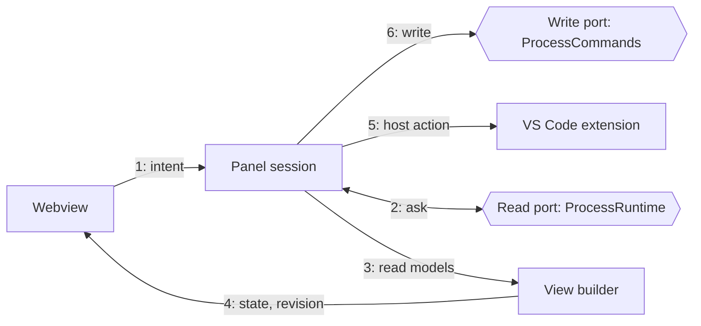
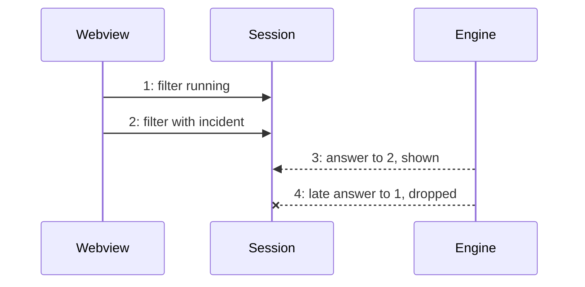

# Core

The engine-neutral logic of Pulse: it answers what the webview asks with complete views.

## Why

The webview should only draw and the extension should only wire VS Code. What lies between is
product logic: which version to show, how incidents group, which load wins, what a retry may touch.
It lives here without VS Code, DOM, Node or engine words, so it runs in the extension, the browser
dev host and tests against a fake engine, and a new engine changes nothing here.

## How it works

1. The webview sends an intent, such as "show instances with an incident". It carries no authority.
2. The panel session reads through the `ProcessRuntime` port and never learns which engine answers.
3. A view builder turns the read models into one view model.
4. The webview gets the complete state with a revision number and drops older revisions.
5. Opening a panel, a quick pick or a write confirmation goes to the extension (`PanelEffects`).
6. A retry or variable change goes through `ProcessCommands`; without it the view is read-only.

Answers can arrive out of order. Only the newest load may publish (`ViewSession`):

## Where things are

- `packages/core/runtime-view/src/core/protocol`: intents, states and view models shared with the webview (`MessageGuards`)
- `packages/core/runtime-view/src/core/panels`: the three panel sessions and their loading (`ViewSession`, `InstanceWrites`)
- `packages/core/runtime-view/src/core/views`: view builders: read models in, one view model out; the engine view takes its numbers from the engine screen of `@miragon/pulse-screens/builder` and its process list's filter from `ProcessFilter` of `@miragon/pulse-screens`, and words them in English (`EngineViewBuilder`); the definition view takes its versions, badges, call targets and the older versions' notice from the process screen of `@miragon/pulse-screens/builder` and its instance rows from its instance list, whose page, scope counts and query its panel reads through the builder's `InstanceList`, `InstanceCounts` and `InstanceQuery` (`InstanceListQuery`, which reads a date condition's wall clock in the host's time zone into the instant the builder takes; a later page joins the rows shown by `InstanceRows` of `@miragon/pulse-screens`), and words them in English (`DefinitionViewBuilder`); the panels read the processes a version calls unless the board builder's `CallActivities` finds no call activity in a diagram it could read (`CallJumps`), as the screens' builder does; the instance view takes its incident cards, wait rows, path, call links, head strip and markers from the instance screen of `@miragon/pulse-screens/builder` and words its codes in English (`InstanceViewBuilder`, `IncidentRows`, `WaitRows`, `PathRows`, `CallLinks`, `InstanceHeadline`), adding what only the editors show (the taken flows, the moves, the variables' editors, the retry and the local model); its rows carry beside the words what the webview's building blocks word themselves (a run's duration in ms, a wait's facts, the head strip the editors show as its code)
- `packages/core/runtime-view/src/core/boards`: the board panel, which reads a board file with `@miragon/pulse-board`, builds its numbers with `@miragon/pulse-board/builder` and hands the webview the model's JSON form (`BoardJson.of` in `BoardViews`) with the targets a click opens and the diagram's XML (`TileViews`), a problem staying a code; the tiles of `@miragon/pulse-blocks` word it in the webview
- `packages/core/runtime-view/src/core/plans`: the migration plan preview, read-only on a `PlanContext` (`MigrationPlanPanel`): it reads a plan file with `@miragon/pulse-migration-plan`, resolves its two version numbers on the engine and checks each pair like an intent of the migration tab before the engine checks the rest; it imports no write, bulk run or confirmation (`plans-start-nothing`)
- `packages/core/runtime-view/src/core/explorer`: what the Engines tree lists
- `packages/core/runtime-view/src/core/drift`: does a local `.bpmn` file match a deployed version? (`ModelDrift`)
- `packages/core/runtime-view/src/core/bpmn`, `packages/core/runtime-view/src/core/diagrams`: text rules for BPMN XML, diagram cache (the root cause of an incident comes with its details from the adapter)

## Rules

- Imports the engine contract (`@miragon/pulse-engine-core`, its main entry), the runtime view's ports, Pulse's UI foundation (`@miragon/pulse-ui/tones`, `/format` in `views/labels.ts`), the board package (`@miragon/pulse-board`, its main entry and `./builder`), the screens package (`@miragon/pulse-screens`, its main entry and `./builder`) and the migration plan format (`@miragon/pulse-migration-plan`, its main entry, in `plans/` alone) only, no `vscode`, Node or other npm package; the protocol none (dependency-cruiser)
- No DOM and no Node globals: `lib` is ES2023 only (`packages/core/runtime-view/tsconfig.core.json`, `packages/core/runtime-view/test/core/runtime.boundary.ts`)
- No engine words, no comments, one class per file, no module functions (ESLint)

## More

[architecture](../../../../../apps/vscode/docs/adr/architecture.md) · [code structure](../../../../../apps/vscode/docs/adr/code-structure.md) · [writes](../../../../../apps/vscode/docs/adr/writes.md) · [guardrails](../../../../../apps/vscode/docs/adr/guardrails.md) · [overview](../../../../../apps/vscode/docs/architecture-overview.md)
