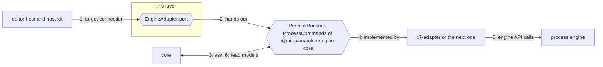

# Ports

The ports only the editor hosts need: the plug every dialect family provides and the local
sources. The engine contract they plug into lives in
[`@miragon/pulse-engine-core`](../../../../connectors/engine/engine-core/README.md).

## Why

Camunda 7 family engines and Camunda 8 hold the same runtime data, named and numbered differently.
The engine contract, `@miragon/pulse-engine-core`, fixes Pulse's questions and the words of the
answers, so the core never learns which engine answers; it is the core of the engine family and
the runtime view's one contract (owner decision 2026-11-09 on #585), imported directly by the
layers that speak it. What only Pulse for VS Code and Pulse for Orca need stays here: connecting to
an engine, the engine's web UI, the command of Pulse's CLI that triggers the event a token waits
for, the local model and its code. The web UI's links differ between the MCP server and the editor
hosts, and only the editors' move refusals name a CLI command, so none of these ports belongs in
engine-core.

## How it works

1. A host gives the adapter of a target's dialect family a connection: endpoint, credentials.
2. The adapter hands out `ProcessRuntime` and, if it can write, `ProcessCommands`.
3. The core asks in Pulse's words: process, version, instance and element ids.
4. Only the adapter behind the ports knows which engine answers.
5. The adapter turns each question into engine API calls and normalises the answer.
6. Facts come back as read models; a missing item is `undefined`, a failure a `RuntimeError`.

## Where things are

- `packages/core/runtime-view/src/ports/index.ts`: the one entry, `@miragon/pulse-runtime-view/ports`
- `packages/core/runtime-view/src/ports/engine-adapter.ts`: the plug every dialect family provides (`EngineAdapter` with `EngineConnection`, `EngineCredentials`, `EngineWebUi`, `EngineCli` and the `CliTarget` it names)
- `packages/core/runtime-view/src/ports/model-source.ts`, `code-locator.ts`, `workspace-files.ts`: the local ports `ModelSource`, `CodeLocator` and `WorkspaceFiles`
- `packages/core/runtime-view/src/ports/local-sources.ts`: the read models of the local sources (the `.bpmn` file and the code that implements an element)
- `packages/connectors/engine/engine-core`: the engine's ports, read models, `RuntimeError`, the kit and the fake

## Rules

- Imports only `@miragon/pulse-engine-core`'s main entry: no other layer, no other npm package, no Node built-in (dependency-cruiser)
- Runs on any host: no DOM, no Node globals (tsc `lib` and `types` of `packages/core/runtime-view/tsconfig.ports.json`, `packages/core/runtime-view/test/ports/runtime.boundary.ts`)
- No engine words such as `camunda` or `processDefinitionKey` (ESLint)
- A new engine question goes into engine-core (port, read model, law and saboteur), never here

## More

[runtime contract](../../../../../apps/vscode/docs/adr/runtime-contract.md) · [writes](../../../../../apps/vscode/docs/adr/writes.md) · [code structure](../../../../../apps/vscode/docs/adr/code-structure.md) · [architecture overview](../../../../../apps/vscode/docs/architecture-overview.md)
