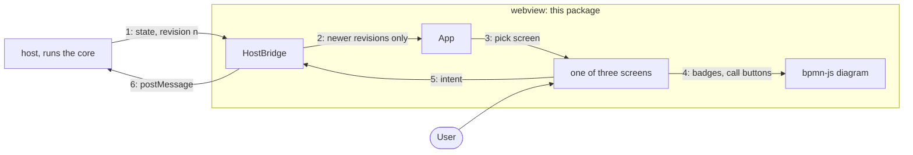

# Webview

The UI inside Pulse's editor tabs: React screens on `@miragon/pulse-ui` and a bpmn-js diagram,
drawn from the view models the core sends.

## Why

A thin renderer: the core decides what a panel shows (rows, counts, badges, whether a write is
allowed); the webview draws it and sends back what the user did. So the logic is tested without
a browser, a click carries no authority, and the same bundle runs in VS Code or a browser.

## How it works

1. The host sends the complete panel state with a revision number, never a patch.
2. The bridge drops any revision that is not newer than the last one it saw.
3. The app picks a screen: loading, failed, or engine, definition or instance by the view's kind.
4. Definition and instance screens draw the deployed diagram with badges, markers, call buttons.
5. A click or a typed search becomes an intent like `filterInstances`; nothing changes locally.
6. The bridge posts the intent to the host; the core acts on it, and its answer is step 1 again.

Only UI state (open tab, split, column widths, zoom) stays in the webview's own VS Code state.

## Where things are

- `packages/core/runtime-view/src/webview/host`: the bridge to the host and the stored UI state (`HostBridge`, `UiStateStore`)
- `packages/core/runtime-view/src/webview/screens`: the three screens, filter bars, instance tabs and the variable editor
- `packages/core/runtime-view/src/webview/diagram`: the bpmn-js viewer with its badges and call buttons (`RuntimeCanvas`)
- `packages/core/runtime-view/src/webview/components`: the webview's parts over pulse-ui's kit: the table with resizable columns, the header bar, tabs, scope segments, the diagram
- `packages/core/runtime-view/src/webview/styles`: the one Tailwind entry (`webview.css`: pulse-ui's `theme.css`, the fonts, the diagram's vendor CSS) and `diagram.css`, the overlays' own classes
- `packages/core/runtime-view/src/webview/theme`: the vendored Miragon canvas (`cd-canvas.css`) and the token values the renderer's paint is pinned to
- `packages/core/runtime-view/dev/webview`, `packages/core/runtime-view/test/webview`: a fixture page, bundle and screenshot scripts; browser tests with a fake host

## Rules

- Takes the core's protocol types, pulse-ui's `/tones` and `/format` (the latter from `format/`),
  pulse-ui's React kit and `theme.css`, and `react`, `react-dom` and `lucide-react`; nothing else
  of ours (dependency-cruiser). It moved from Preact to React on pulse-ui in one switch (D9 in
  `apps/vscode/docs/adr/ui-foundation.md`)
- Composes pulse-ui's pieces and joins classes through its `cn`; the diagram's overlays carry only
  the classes of `diagram.css`, never utilities, so its high-contrast and forced-colours rules win
- `styles/webview.css` puts modeler-shell's `shell.css` in a layer of its own, `shell`, below
  `components` and `utilities`, so its `font: inherit` and `color: inherit` on the controls lose
  to the kit; and it pins the root's font size to 100 %, so pulse-ui's density roles in `rem` keep
  their 16 px base under the 13 px `html` of modeler-shell's stylesheets
- No `vscode` and no Node: it runs in a browser sandbox (dependency-cruiser, `packages/core/runtime-view/tsconfig.webview.json`)
- Colours only from pulse-ui's roles over the Miragon tokens, never `--vscode-*`; no engine words (ESLint)

## Develop and test

- `pnpm --filter pulse-cockpit run build`, then `pnpm --filter pulse-cockpit run dev`, runs the real core on a fake engine at localhost:5180
- `pnpm --filter @miragon/pulse-runtime-view test` runs the browser tests in Chromium with the unit tests; `pnpm --filter pulse-cockpit test` checks the gzip ceilings of the script and the stylesheet the extension ships and that the bundle holds one React (`apps/vscode/test/__golden__/bundle-budget.json`)
- `packages/core/runtime-view/dev/webview/serve.mjs` serves the fixture page with the webview alone, `screenshot.mjs` shoots its fixtures and `bundle-size.mjs` lists what the bundle is made of; run them by hand with `node`

## More

[user interface](../../../../../apps/vscode/docs/adr/user-interface.md) · [protocol](../../../../../apps/vscode/docs/adr/architecture.md#host--webview-protocol) · [writes](../../../../../apps/vscode/docs/adr/writes.md) · [code structure](../../../../../apps/vscode/docs/adr/code-structure.md) · [guardrails](../../../../../apps/vscode/docs/adr/guardrails.md)
